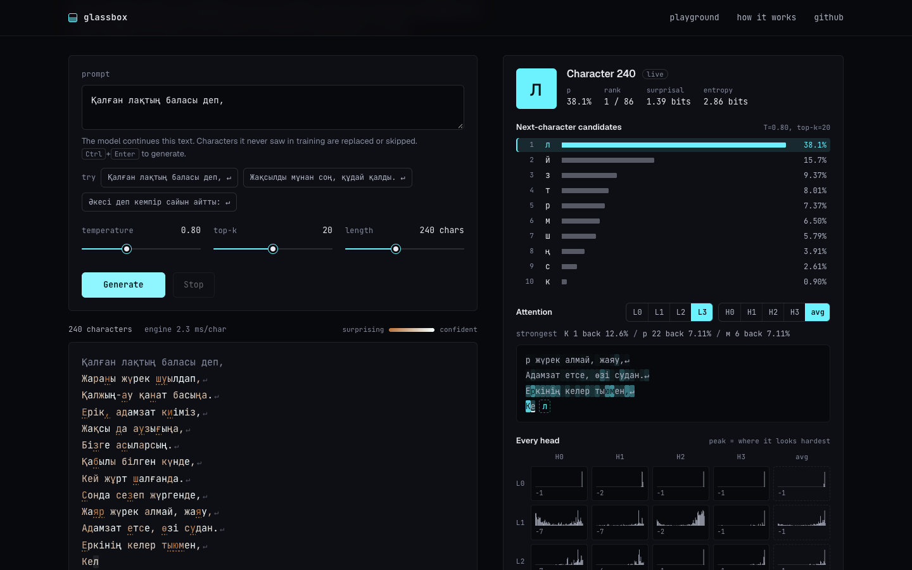

# Glassbox

**A GPT you can see through.** Glassbox is a 1.8M-parameter language model that I trained from scratch on
classic Kazakh poetry. It runs entirely in your browser on a transformer engine I wrote by hand in
TypeScript, with no ML libraries. While it writes, you can open up any character it produced and see the
characters it considered and where each of its 16 attention heads was looking.

**Live demo: [glassbox-fawn.vercel.app](https://glassbox-fawn.vercel.app)**



## What it shows

- **Training from scratch.** I built a corpus of 328,545 characters from public-domain Kazakh classics
  (Abai Kunanbayuly, Akhmet Baitursynuly, Ybyrai Altynsarin and others) on Wikisource, cleaned it, and
  trained a GPT-2-style model in PyTorch on an Apple M4 GPU in 10.8 minutes.
- **Inference from scratch.** The browser engine is about 670 lines of TypeScript (8.8 KB minified). It
  covers matrix multiply, LayerNorm, GELU, causal multi-head attention, a KV cache, and temperature / top-k
  sampling. It generates about 2.3 ms per character in Chrome on an M4.
- **Verified against PyTorch.** On a real 128-character validation snippet, the engine matches PyTorch to
  within 1×10⁻⁶ on the logits and 3×10⁻⁷ on the attention weights. An independent NumPy re-implementation
  checks the exported file format too.
- **Interpretability UI.** Each generated character is tinted by how confident the model was. Select one
  to see the top-10 candidates with their probabilities, surprisal and entropy, the context shaded by
  attention for any layer and head, and a grid of all 16 heads, where you can see the heads specialise.

## The model

| | |
|---|---|
| Architecture | GPT-2 style: pre-LayerNorm, tied embeddings, tanh GELU |
| Size | 4 layers × 4 heads × 192 wide, 128-character context, 1,820,928 parameters |
| Tokenizer | characters: 86 symbols (Kazakh Cyrillic, punctuation, space, newline) |
| Training | AdamW, cosine LR (peak 2e-3), batch 64 × 128, dropout 0.3, 4,500 steps on Apple MPS |
| Loss | train 1.416, validation **1.711** nats/char (best checkpoint, step 3,900) |
| Weights | 3.6 MB of float16, widened to float32 in the browser. Rounding leaves the full validation loss unchanged (1.7170 both ways) |

It writes text with the shape of Kazakh verse: short lines, rhyme-like endings, dialogue with dashes. At
this size most of the words are plausible inventions rather than real meaning. That's expected for a
character model trained on 300k characters, and it's the point: the model is small enough to inspect
completely.

## How it works

```
Wikisource → ml/data.py (clean) → ml/train.py (PyTorch, MPS) → ml/export.py → web/public/model/model.bin
                                                                                │
                              browser: web/src/engine/ (TypeScript, KV cache) ◀─┘ → React UI
```

- [`SPEC.md`](SPEC.md) is the contract between the two halves: the architecture, the binary weight
  format, and the parity fixture.
- [`ml/`](ml) holds the corpus pipeline, the model (`model.py`, hand-written), training, export to float16,
  and the NumPy verifier. [`ml/README.md`](ml/README.md) has the full training notes.
- [`web/src/engine/`](web/src/engine) is the inference engine. It starts in `gpt.ts`: one `advance()`
  pushes tokens through the network and appends to a KV cache, and both `forward()` and each generation
  step reuse it.
- `web/src/` (the rest) is the React UI: playground, inspector, loss chart and architecture diagram,
  with no chart or UI libraries.

## Run it locally

Requires Node 20+.

```bash
cd web
npm install
npm run dev      # http://localhost:5173
npm test         # engine tests, including parity with the PyTorch model
```

To retrain (Python 3.13 and PyTorch):

```bash
/opt/homebrew/bin/python3.13 -m venv ml/.venv
ml/.venv/bin/pip install -r ml/requirements.txt
cd ml
.venv/bin/python data.py && .venv/bin/python train.py && .venv/bin/python export.py && .venv/bin/python verify_export.py
```

## Stack

PyTorch · NumPy · TypeScript · React 19 · Vite · Vitest

## License

The code is [MIT](LICENSE). The training texts are in the public domain (see Credits).

## Credits

The training texts are public-domain works by Kazakh authors who died between 1881 and 1938,
transcribed on [Wikisource](https://wikisource.org/wiki/Category:Kazakh).

Built by [Nazar Akanov](https://portfolio-alpha-sandy-krad8msap8.vercel.app).
